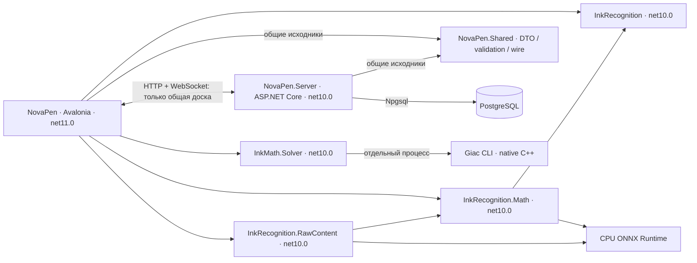
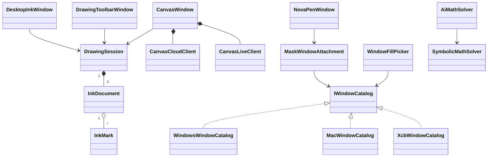

# Архитектура и границы ответственности

NovaPen — нативное приложение Avalonia с локальным документом чернил, платформенными масками и дополнительной синхронизацией доски. Распознавание и символьные вычисления выделены в библиотеки. Сервер хранит общие доски и передаёт события участников; вычисления и распознавание к нему не обращаются.

## Модули и направление зависимостей

Схема отражает ссылки из `.csproj`. `NovaPen.Shared` подключается как общий исходный код через `Compile Include`, отдельной сборки у него нет. Стрелка означает «использует».

| Модуль | Отвечает за | Граница |
|---|---|---|
| [NovaPen](../../src/NovaPen) | Окна, ввод, инструменты, редактирование, настройки, выбор распознавателя, показ результата, синхронизация доски | UI управляет жизненным циклом. Изменение распознанного результата проходит через документ и отмену; сервер не получает экранные чернила |
| [NovaPen.Shared](../../src/NovaPen.Shared) | `BoardSnapshot`, `BoardPatch`, контракты live-протокола, проверка ограничений и сериализация | Нет Avalonia, окон, БД или распознавателя. Клиент и сервер используют один формат |
| [InkRecognition](../../src/InkRecognition) | Геометрия штрихов, текстовые ресурсы, распознавание и проверяемые восстановленные операции текстового движка | Нет окон приложения и сетевой синхронизации. Восстановленные внутренние операции не означают готовый полный декодер |
| [InkRecognition.Math](../../src/InkRecognition.Math) | Признаки штрихов, Math2-модели и декодирование математической записи | Распознаёт запись, но не вычисляет её значение и не выбирает место в документе |
| [InkRecognition.RawContent](../../src/InkRecognition.RawContent) | Локальная классификация и сегментация содержимого штрихов с модельным runtime | Не владеет UI, документом, сервером или решателем; зависит от математической библиотеки |
| [InkMath.Solver](../../src/InkMath.Solver) | Разбор разрешённого LaTeX, запрос к Giac, нормализация ответа, тайм-аут и отмена процесса | Нет Avalonia, моделей и облака. Все вычисления выполняет Giac; встроенного запасного вычислителя нет |
| [NovaPen.Server](../../src/NovaPen.Server) | HTTP API, доступ по ключам приглашений, транзакции досок, live-события и страница загрузки | Не распознаёт штрихи, не решает формулы и не является веб-редактором. Постоянное хранение — PostgreSQL |
| [tools](../../tools), [packaging](../../packaging), [models](../../models/README.md) | Проверки, сборка, установщики и модельные ресурсы | Контрольный CLI и исследовательский прототип не включают функцию в приложение автоматически |

## Сеанс рисования и документ

[`DrawingSession`](../../src/NovaPen/DrawingSession.cs) связывает инструменты, панель, экранные окна и доску. Он владеет двумя `InkDocument`: экранным и доски. Активный документ определяется `DrawingTarget`; переключение поверхности не смешивает историю изменений.

[`InkDocument`](../../src/NovaPen/InkDocument.cs) хранит `InkMark`, группирует изменения в операции, ведёт undo/redo и сообщает об изменениях. `Preview` и `FadingMarks` относятся к представлению: незаконченные и исчезающие чернила не становятся сохранёнными объектами доски. Рисование выполняют поверхности, а не сетевой клиент.

`DesktopInkWindow` обслуживает экранный ввод и отрисовку с физическими координатами рабочего стола. `CanvasWindow` управляет отдельной доской, масштабом, локальным состоянием и соединением. `DrawingToolbarWindow` меняет режимы через сеанс. Эти окна не реализуют математические алгоритмы или хранение PostgreSQL.

Ниже показаны основные связи классов, а не все поля и методы. Композиция отмечает владение в текущем коде; обычная стрелка — использование.

## Маски и платформенные окна

[`NovaPenWindow`](../../src/NovaPen/NovaPenWindow.cs) отвечает за вид и ввод самой маски. [`WindowFillPicker`](../../src/NovaPen/WindowFillPicker.cs) выбирает регион под указателем и хранит текущий предпросмотр; он не создаёт маску. Подтверждение заново проверяет регион перед созданием.

[`IWindowCatalog`](../../src/NovaPen/NativeWindowCatalog.cs) отделяет поиск, чтение геометрии и размещение относительно чужого окна от UI. Реализации `WindowsWindowCatalog`, `MacWindowCatalog`, `XcbWindowCatalog` владеют платформенным interop. [`MaskWindowAttachment`](../../src/NovaPen/MaskWindowAttachment.cs) отслеживает цель, а [`MaskAttachmentCoverage`](../../src/NovaPen/MaskAttachmentCoverage.cs) определяет защищённый прямоугольник после движения или изменения размера. Отрисовка эффекта не должна самостоятельно выбирать другое целевое окно.

В Windows заливка выбирает верхнее видимое чужое окно, включая окна без заголовка, затем нативный дочерний регион. Границы дочернего окна ограничиваются клиентскими областями предков. События и таймер поддерживают привязку после выбора; предпросмотр и подтверждение используют один каталог. На macOS доступен выбор целого окна, на X11 — дочернего региона; нативный Wayland не предоставляет нужную геометрию. Это ограничение платформы, а не задача распознавателя.

## Распознавание и вычисления — разные этапы

Код `Ai*` в приложении объединяет пользовательский ввод, сегментацию, вызов библиотеки, размещение печатного результата и возможность отмены. Геометрия и уверенность результата не должны подменяться текстом из исследовательского отчёта. Неуверенный ввод может оставаться рукописным.

[`AiMathSolver`](../../src/NovaPen/AiMathSolver.cs) проверяет настройку Giac и выбирает исполняемый файл. [`SymbolicMathSolver`](../../src/InkMath.Solver/SymbolicMathSolver.cs) разбирает ограниченный вход, запускает CLI в отдельном временном каталоге, ограничивает вывод и время, завершает процесс при отмене. Giac вычисляет формулу после распознавания; качество распознавания формулы не доказывается успешным вычислением вручную заданного LaTeX. При отключённом или недоступном Giac запасного калькулятора нет.

Русский текстовый путь и полный английский MAIN-декодер остаются незавершёнными. Проверки отдельных функций, модельных признаков и этапов владения доказывают только свои условия. Исследовательские квоты, планы и артефакты находятся в [research](../agents/research/README.md); контракты интеграции — в [распознавании](recognition.md) и [математическом runtime](math-runtime.md).

## Общая доска и сервер

[`CanvasCloudClient`](../../src/NovaPen/CanvasCloudClient.cs) выполняет HTTP-запросы создания, чтения и изменения доски. [`CanvasLiveClient`](../../src/NovaPen/CanvasLiveClient.cs) передаёт временные штрихи и принимает live-уведомления. `CanvasState` хранит локальную доску, базовую ревизию, соединение и ожидающую операцию; `CanvasMerge` вычисляет изменения и перебазирует локальную работу относительно серверного снимка. UI применяет результаты на своём потоке.

На сервере [Program.cs](../../src/NovaPen.Server/Program.cs) задаёт маршруты и ограничения запросов. [`BoardStore`](../../src/NovaPen.Server/BoardStore.cs) проверяет права и изменяет PostgreSQL в транзакциях с идентификаторами операций, защищающими от повторного применения. [`BoardLiveHub`](../../src/NovaPen.Server/BoardLiveHub.cs) обслуживает участников и временные события; незаконченные превью не заменяют постоянное сохранение.

Ключи приглашений разделяют право просмотра и изменения. Общие DTO не содержат оконных объектов или объектов распознавателя. События live-хаба живут в памяти одного серверного процесса; несколько реплик потребуют общего транспорта событий. Сейчас отдельного брокера в архитектуре нет. Инструкции по БД, резервным копиям и развёртыванию: [self-hosting](deployment.md).
