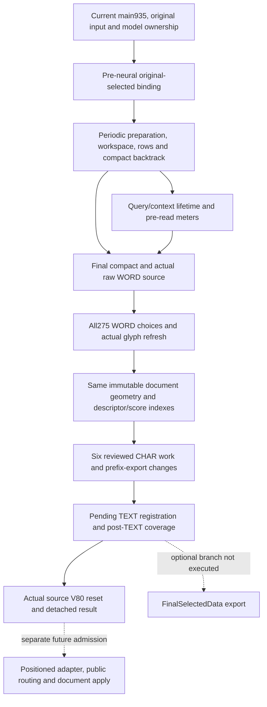

# English admission dependency review: main935 versus completed isolated950

This is a follow-up to `../portable`, not a replacement for its completed owning proof. No repository files were changed. No vendor code or GUI was executed. No production admission is claimed.

## Concrete inventory

Base main commit:4436c4f9decd2144018cc1e4e52200535b10a85d. All935 main source hashes were authenticated before making isolated overlays. Candidate950 differs by15 added and69 changed source files. Only6 changes belong to the completed-CHAR work;63 changes and all15 additions were inherited. `delta-classification.json` covers every one of the84 deltas with exact source hashes, origin, category and compile-frontier membership. The completed packet preserves the entire950/main935 pin sets; `diffs/` preserves every changed-file unified diff.

The project file is a separate delta: current main retains optional BLURMASK_PUBLICATION_DIAGNOSTICS and its two linked tool sources. The old stage project lacks them. Preserve current main project metadata and diagnostic tooling.

## Confirmed unwanted reversions in the old stage

These are observed source differences, not hypothetical risks:

| Old950 delta | Current main behavior to retain | Why excluded |
|---|---|---|
| ExperimentalGlobalTextRecognizer + Batch | score domain0..1, NativeSelectedText=true |950 restores .5 floor and removes selected-text receipt |
| StrokeTextRecognizer | NativeSelectedText property |950 removes public result metadata used by current host |
| LegacySourcePointChronology | fresh source scale200 |950 restores1; changes input timing |
| LegacyFloatContextGeometry | rounded extent-plus-one comparison, equal keeps width |950 restores Math.Max(raw extents), changes rare ties |
| LegacyDegenerateFloatContextGeometry | (0f-reference)/four |950 restores unary negation; signed-zero behavior differs |
| FreshMainGlobalPlainRecognition/WordAugmentation/WordTextPublication; NativePlainWordPublisher + Augmentation; GlyphRecordPool.Cleanup | current conditional diagnostic tracing |950 strips existing diagnostics; unnecessary for English completion |

Do not treat those deltas as English dependencies merely because they are present in950. Score-cache FirstOrdinalIndex is a different, opt-in numerical optimization and requires its existing independent equivalence evidence; the table does not declare it incorrect.

## Dependency DAG and authority boundaries

This is an execution/ownership layer DAG, not a claim that each file forms an acyclic call graph. Shared partial types contain mutual compile dependencies. The original owning capture proves the complete950 composition through J, with observed v/r alternatives; it proves neither K nor recognition accuracy.

Layer implementation anchors:

- B: `LegacyEnglishOriginalInputContext`, `GraphEarlySelectedInput`, `GraphWordSourceCompletion.RunGraphFirstPeriodicPendingText`.
- C: PeriodicPreparation/Workspace/Rows/BacktrackRows/AlternativeWalk/Compact/Cost; GraphLoop/LanguageStage; Node1Preparation and execution pool adapters.
- D: PeriodicQueryBudget and ContextBudget; PreparedDictionaryQuerySource; normal/aux/delimiter/aggregate wrapper propagation, SymbolContextFactory. Their hooks must be installed and torn down, not merely compile.
- E: GraphPhase1/FinalCompact/RawWord/Materialization, ordinary parent candidates, typed range receipts and traversal meter.
- F/G: GraphWordPublication/GlyphChoices/GlyphDispatch/RefreshAllocation/GlyphGeometry; pool DescriptorBatch, indexed refresh, score FirstOrdinalIndex, immutable document map/root observations.
- H/I: the exact six-file portable packet, CharacterBindings + Characters, private optional reuse meter, scalar publisher count, source range post-TEXT bound.
- J: GraphLoop and Node0Completion end/reset reservation plus wrapper/context teardown. Do not import old caps or skip source reset.

## Measured compile frontier

`analyzer/Program.cs` builds a real Roslyn semantic compilation against installed .NET10.0.12 reference assemblies, with SDK implicit usings. It never emits or executes a recognition assembly. Full950 binds with0 errors. Reports preserve the exact staged overlays:

| Experiment | Overlay on authenticated main935 | Authored sources | Errors |
|---|---|---:|---:|
| frontier01 |15 additions +6 reviewed changes |950 |50 |
| frontier02 |symbol-owner and periodic preparation layer; omit optional export |949 |17 |
| frontier03 |range/geometry/index/owning binding dependencies; restore gated export |950 |3 |
| frontier04 |remaining outer-wide and indexed refresh symbols |950 |0 |

Frontier04 uses15 added +37 changed files, preserving32 current-main changed files. It also binds with BLURMASK_PUBLICATION_DIAGNOSTICS and the real two linked diagnostic sources:952 source trees,0 errors. The unlinked first diagnostic experiment was superseded; the retained report uses the actual conditional link inputs.

**Frontier04 is not a runtime integration candidate.** Compile success does not prove the omitted wrapper meters or preparation allocation census. For example, normal/aux/aggregate query hooks and Node0Completion's added nullable-reference allocation/reset accounting are among the excluded files. Running it as if its counters were sufficient would be misleading. No owning run was made against frontier04. It is a reproducible lower frontier of whole-file compile dependencies, not a mathematically minimal hunk set.

FinalSelectedData is absent from the executed pendingTEXT request flags, but whole-file WordPublication retains a gated `CopyFinalSelectedData` call. Therefore omitting that new file causes compile dependencies unless the unused branch is separately rebased out. This is a concrete reason to integrate reviewed hunks instead of whole partial files.

`semantic-file-edges.json` contains12667 bound source-to-source file edges with symbol names, from an error-free full950 compilation. Namespace edges are excluded. Partial type references deliberately overapproximate every declaration and must not be interpreted as execution reachability. `narrow-member-edges.json` is a convenience heuristic, not the authority.

## Strict next integration recipe

1. Make a fresh isolated checkout of the authenticated current main. Keep current project metadata, public routing, accepted score domain, geometry/timing corrections and diagnostic code. Source-authenticate both main935 and the completed950 packet before extracting hunks. Refuse unknown preimages.
2. Review/install the internal periodic route as layers B-J. Separate structural partial declarations from semantic changes. Start with the52-file compile frontier to resolve symbols, then bring only actual required lifecycle/meter hooks from the other internal files. Every hook omitted must have a source reason or equivalent pre-read bound; compiling alone is insufficient. Do not copy all84 deltas as a shortcut.
3. Review score/descriptor/index/geometry reuse controls from their original pinned packets. The six-file completed packet only adds its own1363 numeric,46 Process-prefix,41 cancellation cases; it does not retroactively prove the other inherited optimizations. Retain original default/public callers and allocation/copy/reset envelopes.
4. Produce the minimal hunk dependency manifest: every included hunk gets main preimage hash, new hash, controlling opt-in branch and evidence; every excluded inherited hunk gets a reason. FinalSelectedData can stay out if its unused gated call is removed as one separately reviewed hunk. This minimal runtime manifest is still outstanding.
5. Build the rebased isolated library with unchanged logical caps and exact portable PDB verification, both normal and diagnostic configurations. Run default/public guards and relevant existing1024 reuse controls in addition to the packet controls; verify optional meter remains null for existing callers.
6. Repeat original141 indexes4,5,60,64, same pinned models/input/resolution/limits, plus matching-token caller cancellation. Compare actual candidates/UTF8 and full ownership/reset receipts. Current-main timing/geometry may legitimately expose a new result; record it rather than restoring an old implementation to reproduce v. Index4 completion alone is not a quality or public-route admission.
7. Only after that evidence, review K separately. No NativeSelectedText/public adapter/default recognition switch follows automatically from a pendingTEXT result.

The next concrete admission boundary is the rebased B-J runtime manifest and owning replay. This packet accelerates it with exact source differences, executable compile diagnostics and known exclusions; it does not erase that remaining proof obligation.
